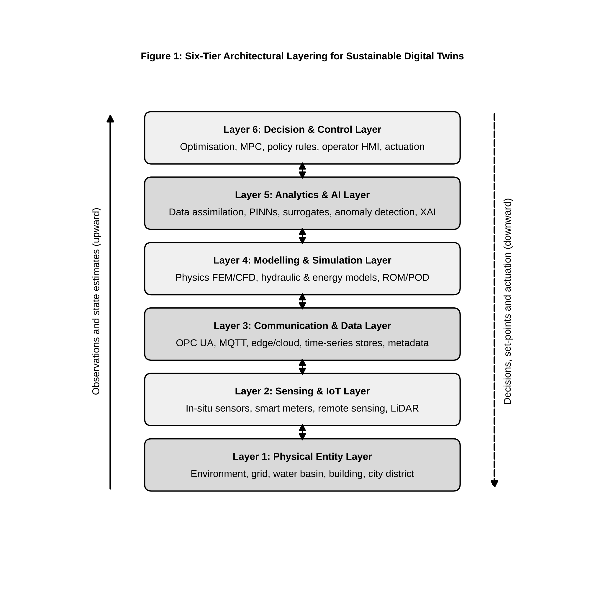
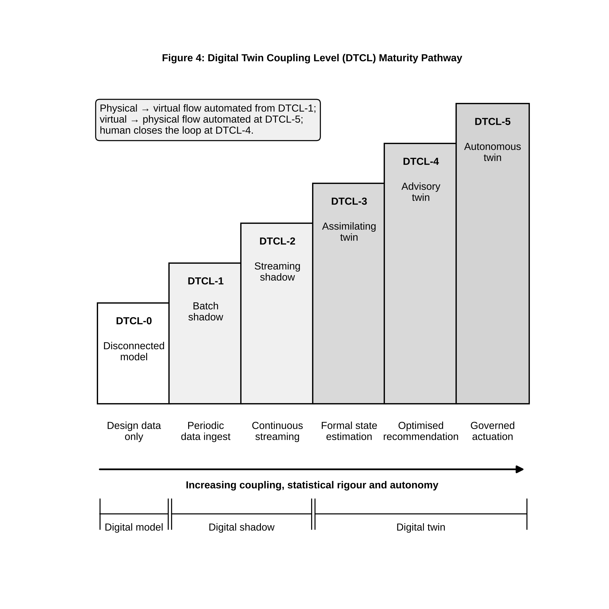

# Digital Twins for Sustainable Systems: Multiscale Modeling, Data Assimilation, Prediction and Decision Support

**Uday Pratap Singh\***

Department of AI & DS, Poornima Institute of Engineering & Technology, Jaipur, Rajasthan, India

\*Corresponding email: udaypratap@allduniv.ac.in

ORCID ID: [Insert Valid 16-digit ORCID ID]

## Abstract

Digital twins are computational representations of physical systems that are kept consistent with those systems through observation and are used to evaluate how the systems would behave under alternative operating conditions. For sustainability, their value lies less in visualisation or real-time dashboards than in the disciplined combination of heterogeneous observations, physical models, data-driven forecasting and decision-making under explicit uncertainty. This chapter examines digital twins for environmental, energy, water, urban and resource systems. It first separates static digital models, digital shadows and fully coupled digital twins, and proposes a six-level Digital Twin Coupling Level (DTCL) taxonomy that grades twins by the direction, latency and statistical rigour of the information exchanged between the physical and virtual domains. A six-tier reference architecture is then described, followed by a treatment of the data foundation, including the ensemble Kalman filter and its covariance and rank properties. Physics-based, data-driven, reduced-order and physics-informed modelling strategies are compared, and the mathematics of proper orthogonal decomposition and physics-informed neural-network losses is set out. Prediction, calibration, uncertainty propagation and drift management are treated as continuous processes rather than one-off steps. Applications in water, air quality, circular resources, ecosystems, agriculture, buildings, renewable energy and grids are reviewed, together with multi-objective optimisation for resource efficiency and carbon reduction. The chapter closes with a structured analysis of interoperability, data quality, computational cost, cybersecurity, validation, explainability, infrastructure sustainability and human oversight, and outlines research directions toward trustworthy, adaptive and climate-resilient twins.

**Keywords:** Digital twins; sustainability; data assimilation; physics-informed machine learning; environmental monitoring; energy systems; decision support

## 1. Introduction

### 1.1 From digital models to digital twins

Engineering has relied on mathematical models for as long as it has had calculus, and on computer models for more than half a century. A finite-element mesh of a dam, a hydraulic network model of a city's water mains, or an energy simulation of an office tower are all digital models: abstractions that answer "what if" questions about a design. What such models lack is a persistent, two-way relationship with one specific physical asset as it ages, degrades and is operated. The digital-twin concept was formulated precisely to supply that relationship. Grieves and Vickers describe the twin as a virtual counterpart linked to its physical product across the whole lifecycle, intended to expose emergent and undesirable behaviour before it materialises [1]. The aerospace community adopted a similar view, defining the twin as an integrated, multiphysics, multiscale and probabilistic simulation of an as-built vehicle that mirrors the life of its flying twin using the best available models and sensor data [2].

The distinction is therefore not one of fidelity. A coarse model that is continuously corrected by data may be a twin; a high-resolution simulation run once at the design stage is not. What makes a twin is the closure of an information loop between a particular physical entity and its virtual representation [3, 4].

### 1.2 Why sustainability requires dynamic system representations

Sustainability problems share three features that defeat static analysis. First, they are non-stationary: catchment hydrology shifts with land use and climate, building loads change with occupancy patterns, and electricity networks evolve as variable renewable generation displaces dispatchable plant. Second, they are coupled across scales, so that a local intervention such as a pumping schedule or a demand-response signal propagates to regional water balances or grid stability. Third, they are judged on several objectives at once, including cost, emissions, resource use, resilience and equity. A design-stage model, frozen at commissioning, drifts away from the real system and becomes a poor guide to operational decisions. The Earth-system community has drawn the same conclusion at planetary scale, arguing that a digital twin of the Earth that fuses kilometre-scale simulation with observations is needed to support the green transition [5]. A dynamic representation, continuously reconciled with observations, is the minimum condition for credible operational sustainability decisions.

### 1.3 Digital twins versus conventional simulation and monitoring systems

Conventional simulation is forward and open-loop: inputs are specified, a model is run, outputs are interpreted. Conventional monitoring, typically realised as supervisory control and data acquisition (SCADA) systems or Internet-of-Things (IoT) dashboards, is observational and model-free: it reports what sensors measure but cannot infer unobserved states or project future behaviour. A digital twin joins the two. Observations constrain the model state, the model fills gaps between sensors and extends them into the future, and the resulting estimates inform actions that change the physical system, which is then observed again [6, 7]. Three properties follow from this coupling: (i) the twin can estimate quantities that are never directly measured, such as pollutant concentration between monitoring stations; (ii) its predictions carry quantified uncertainty derived from both model and observation errors; and (iii) its value can be judged by the quality of the decisions it enables, not only by its accuracy.

### 1.4 The purpose and scope of this chapter

The literature on digital twins is large but fragmented. Systematic reviews report inconsistent use of the term and frequent conflation of twins with ordinary simulation or monitoring tools [3, 8]. This chapter aims to give a coherent, mathematically grounded treatment oriented toward sustainable systems. Section 2 establishes definitions and introduces the Digital Twin Coupling Level taxonomy. Section 3 presents a six-tier reference architecture. Sections 4 to 6 develop the data, modelling and uncertainty foundations, including data assimilation and physics-informed learning. Sections 7 and 8 survey environmental, resource, energy and built-environment applications. Section 9 addresses optimisation and decision support, Section 10 compares documented implementations, Section 11 analyses open challenges, Section 12 discusses future directions and Section 13 concludes.

## 2. Foundations of Digital Twin Technology

### 2.1 Concept and evolution of digital twins

The intellectual lineage of the digital twin runs through product lifecycle management, where Grieves introduced the triad of a physical product, a virtual product and the data flows connecting them [1]. Aerospace engineering then gave the concept its probabilistic, multiphysics character, motivated by structural-health management of airframes whose individual load histories differ from fleet averages [2]. Manufacturing extended it to production lines and factories under the banner of cyber-physical production systems [4]. Environmental and Earth-system science adopted the concept later, but brought with it decades of experience in data assimilation for numerical weather prediction, which in many respects is the oldest operational digital twin in existence [5, 9]. This convergence matters: the manufacturing tradition contributes architecture and lifecycle thinking, while the geoscience tradition contributes rigorous statistical state estimation.

### 2.2 Physical entity, virtual representation and data connection

Every twin has three constituents. The *physical entity* is the bounded real-world system of interest: a pump station, a watershed, a building, a district heating network. Its boundary must be defined explicitly, because exchanges of mass, energy and information across that boundary become forcing terms or boundary conditions in the virtual model. The *virtual representation* is a set of models, often of different types and resolutions, that together describe the state, dynamics and response of the entity. The *data connection* comprises sensors, communication links, data pipelines and the algorithms that translate observations into state corrections and decisions into actuator commands [4, 7]. Jones et al. identified thirteen characteristics recurring in the literature, among them the physical-to-virtual and virtual-to-physical connections, twinning rate and fidelity [8]. For sustainable systems, the twinning rate, meaning the frequency with which the virtual state is synchronised, must be chosen relative to the characteristic time scale of the process: minutes for grid frequency, hours for building thermal response, days to weeks for groundwater.

### 2.3 Digital model, digital shadow and digital twin

Kritzinger et al. proposed a classification based on the automation of data flows [3]. In a *digital model*, data exchange between physical and virtual objects is manual in both directions. In a *digital shadow*, data flow automatically from the physical to the virtual object, while any influence in the reverse direction is manual. In a *digital twin*, flows are automatic in both directions. This classification is valuable because it is operational: it can be checked by inspecting a system's interfaces. It is also coarse. It does not distinguish a shadow that merely displays sensor values from one that performs statistically optimal state estimation, nor a twin that issues advisory recommendations from one that actuates equipment autonomously.

### 2.4 Levels of coupling between physical and digital systems

To resolve that coarseness, this chapter proposes a Digital Twin Coupling Level (DTCL) taxonomy with six graded levels, defined by three measurable attributes: the direction of automated information flow, the synchronisation latency $\tau_s$ relative to the dominant process time scale $T_p$, and the statistical treatment of the mismatch between model and observation.

- **DTCL-0, Disconnected model.** No automated data link; the model is parameterised from design data or one-off surveys.
- **DTCL-1, Batch shadow.** Observations are ingested periodically and used for visual comparison or offline recalibration; $\tau_s \gg T_p$.
- **DTCL-2, Streaming shadow.** Observations are ingested continuously and displayed beside model output, but the model state is not corrected; $\tau_s \lesssim T_p$.
- **DTCL-3, Assimilating twin.** The model state, and possibly its parameters, are updated by a formal estimator such as a Kalman-type filter or variational method, yielding a posterior state with uncertainty [9].
- **DTCL-4, Advisory twin.** An assimilating twin that also evaluates candidate interventions and returns ranked recommendations to a human operator, who closes the loop.
- **DTCL-5, Autonomous twin.** The loop is closed automatically: the twin selects and executes control actions within governed limits and monitors their effect.

The ladder is cumulative; each level presupposes the capabilities of the one below. It maps onto Kritzinger's classes, since DTCL-0 corresponds to a digital model, DTCL-1 and DTCL-2 to shadows and DTCL-3 to DTCL-5 to twins, but it separates engineering maturity from interface automation. It also makes clear that progressing from DTCL-2 to DTCL-3 demands statistical machinery, not only connectivity. The maturity pathway is summarised later in Figure 4.

### 2.5 Static, predictive and adaptive twins

A second, orthogonal axis concerns temporal capability. A *static* twin describes the current or recent state of the asset. A *predictive* twin propagates that state forward to produce forecasts with uncertainty. An *adaptive* twin additionally revises its own structure or parameters in response to evidence that the physical system has changed, for example after sensor replacement, retrofitting or a regime shift in climate forcing [6]. Sustainability applications almost always require predictive capability, because interventions such as reservoir releases, storage dispatch or ventilation schedules must be planned before the conditions they respond to occur. Adaptive capability becomes essential over the long asset lifetimes typical of infrastructure.

### 2.6 From monitoring to simulation and decision support

Taken together, the coupling and temporal axes define a progression from monitoring through simulation to decision support. Monitoring answers "what is happening?", estimation answers "what is the full state, including unmeasured variables?", prediction answers "what will happen?", and decision support answers "what should be done, and with what expected consequences and risks?". Each step adds value and also adds obligations: a twin that recommends actions must justify them, quantify their uncertainty and record their provenance [6, 7]. The remainder of the chapter treats these obligations as design requirements rather than afterthoughts.

## 3. Digital Twin Architecture for Sustainable Systems

Architectures for digital twins have been described in many ways, from three-dimensional models comprising physical, virtual and connection parts to five-dimensional variants that add data and services [4]. For sustainable systems, a six-tier layering, shown in Figure 1, has the advantage of separating concerns whose technologies, owners and failure modes differ.

### 3.1 Physical layer

The base tier is the physical system itself, which may be engineered (a treatment plant, a microgrid), natural (a river reach, a forest stand) or socio-technical (a city district). Defining this tier means stating the system boundary, the state variables of interest, the available control inputs and the exogenous drivers such as weather, demand and markets. In environmental twins the controllable fraction of the system is often small: a basin operator controls reservoir gates but not rainfall. The twin must therefore represent uncontrolled drivers probabilistically.

### 3.2 Sensing and IoT layer

The second tier converts physical quantities into data. It includes in-situ sensors for flow, pressure, temperature, water quality, particulate matter and power; remote-sensing platforms such as satellites, aircraft and drones; and human-generated observations such as inspection reports. Sensor placement determines observability: a state component that does not influence any measurement cannot be corrected by assimilation and is constrained only by the model. Placement design is therefore an optimisation in its own right, trading sensor cost against expected reduction in posterior uncertainty.

### 3.3 Communication and data-management layer

The third tier moves, stores and curates data, and IoT connectivity and data management are recurrently identified as core enabling technologies of twins [7]. Industrial protocols such as OPC Unified Architecture (OPC UA) and lightweight publish–subscribe protocols such as MQTT are widely used for transport, while time-series databases, object stores and data lakes provide persistence. Edge nodes may pre-process and compress data before transmission, which reduces bandwidth and energy use. This tier is also where metadata, units, coordinate reference systems, timestamps and quality flags must be attached and preserved, because errors introduced here propagate silently into every model above.

### 3.4 Modelling and simulation layer

The fourth tier hosts the virtual representation: mechanistic models such as computational fluid dynamics (CFD), finite-element, hydraulic, hydrological or building-energy simulations, together with reduced-order surrogates that make them fast enough for operational use [6]. Multiscale coupling is often required, for instance a catchment rainfall–runoff model driving a one-dimensional river model that in turn supplies boundary conditions to a two-dimensional inundation model.

### 3.5 Analytics and artificial intelligence layer

The fifth tier contains statistical and machine-learning components: data assimilation, anomaly detection, forecasting, surrogate modelling, physics-informed learning and explainability tools [10, 11]. The boundary with the modelling tier is deliberately permeable, since hybrid models combine mechanistic and learned components within a single computational graph.

### 3.6 Decision and control layer

The sixth tier turns estimates and forecasts into actions. It includes optimisation engines, rule-based policies, model-predictive controllers and human–machine interfaces. Its outputs range from advisory reports at DTCL-4 to automated set-points at DTCL-5. Governance rules, including operating envelopes, approval workflows and fail-safe defaults, belong in this tier.

### 3.7 Feedback between physical and virtual environments

The defining property of the architecture is closure of the loop. Observations ascend from tiers 1 to 5; decisions descend from tier 6 to tier 1; the consequences of those decisions are observed again. Two latencies govern the loop: the *sensing-to-estimate* latency, which bounds how current the twin's state is, and the *decision-to-effect* latency, which bounds how quickly interventions act. Stable operation requires the total loop latency to be short relative to the process time scale, and requires that the twin anticipate rather than chase disturbances. In that sense the architecture is a feedback controller, and the familiar concerns of control engineering, namely stability, robustness and delay, apply to it in full.

## 4. Data as the Foundation of Environmental and Sustainable Digital Twins

### 4.1 Sensor and IoT observations

In-situ sensors supply the highest temporal resolution but sparse spatial coverage. Low-cost IoT devices have increased coverage substantially, for instance in urban air-quality networks, but at the price of drift, cross-sensitivity to humidity and temperature, and calibration offsets that vary between units. Treating such observations as error-free is a common and serious mistake. Each observation should carry an error model, at minimum a variance, that the assimilation layer can use to weight it against the model forecast.

### 4.2 Remote sensing and geospatial data

Satellite and airborne platforms provide spatially continuous fields such as land-surface temperature, soil moisture, vegetation indices, surface-water extent and atmospheric composition. Their temporal sampling is limited by revisit times and cloud cover, and their retrievals are themselves model-dependent inferences. For large-scale environmental twins, gridded reanalysis products are often used as background states and boundary forcing. ERA5, for example, provides hourly estimates of atmospheric, land and ocean-wave variables at about 31 km horizontal resolution on 137 vertical levels, produced by assimilating observations into a numerical weather prediction model [12].

### 4.3 Historical databases and simulation-generated data

Historical records such as utility billing data, maintenance logs, past hydrographs and archived SCADA streams provide the long baselines needed to train statistical models and characterise rare events. Simulation-generated data, produced by running high-fidelity models across designed parameter sweeps, are the principal training resource for surrogates and reduced-order models [6]. Mixing observed and simulated data requires care, because simulated data inherit the structural biases of the model that produced them.

### 4.4 Data quality, missing observations and sensor uncertainty

Operational data streams contain gaps, spikes, flat-lines, clock errors and unit inconsistencies. A robust twin applies automated quality control, including range, rate-of-change, persistence and spatial-consistency checks, before assimilation, and records the result as a quality flag rather than silently deleting data. Missing observations are handled naturally in a Bayesian framework: when a sensor is absent, the corresponding row of the observation operator is removed, and the analysis reverts toward the model forecast with correspondingly larger uncertainty [9].

### 4.5 Spatial and temporal data integration

Heterogeneous sources differ in support, the spatial and temporal footprint over which a measurement averages. A point gauge, a 10 m satellite pixel and a 31 km reanalysis cell do not measure the same quantity even when they report the same variable. Integration therefore requires explicit observation operators that map the model state to the support of each observation, together with representativeness-error terms that account for unresolved variability. Temporal alignment poses parallel problems: asynchronous observations are best assimilated at their true observation times, either by four-dimensional methods or by time-windowed sequential updates.

### 4.6 Data assimilation and state estimation

Data assimilation is the formal mechanism by which a twin moves from DTCL-2 to DTCL-3. Consider a discrete-time state vector $\mathbf{x}_k \in \mathbb{R}^{n}$ evolving under a possibly nonlinear model $\mathcal{M}$ with additive model error, and observed through an operator $\mathbf{H}_k$:

$$
\mathbf{x}_k = \mathcal{M}_{k-1\rightarrow k}(\mathbf{x}_{k-1}) + \boldsymbol{\eta}_k, \qquad \boldsymbol{\eta}_k \sim \mathcal{N}(\mathbf{0}, \mathbf{Q}_k), \qquad (1)
$$

$$
\mathbf{z}_k = \mathbf{H}_k \mathbf{x}_k + \boldsymbol{\epsilon}_k, \qquad \boldsymbol{\epsilon}_k \sim \mathcal{N}(\mathbf{0}, \mathbf{R}_k), \qquad (2)
$$

where $\mathbf{z}_k \in \mathbb{R}^{m}$ is the observation vector, $\mathbf{H}_k \in \mathbb{R}^{m\times n}$, $\mathbf{Q}_k \in \mathbb{R}^{n\times n}$ is the model-error covariance and $\mathbf{R}_k \in \mathbb{R}^{m\times m}$ is the observation-error covariance. The ensemble Kalman filter (EnKF), introduced by Evensen [13], represents the forecast distribution with an ensemble of $N$ members $\{\mathbf{x}_k^{f,(i)}\}_{i=1}^{N}$, each propagated through the full nonlinear model. The ensemble mean $\bar{\mathbf{x}}_k^f$ and the anomaly matrix

$$
\mathbf{A}_k = \frac{1}{\sqrt{N-1}}\left[\mathbf{x}_k^{f,(1)}-\bar{\mathbf{x}}_k^f,\; \ldots,\; \mathbf{x}_k^{f,(N)}-\bar{\mathbf{x}}_k^f\right] \in \mathbb{R}^{n\times N} \qquad (3)
$$

define the sample forecast covariance $\mathbf{P}_k^f = \mathbf{A}_k\mathbf{A}_k^{T}$. Each member is then updated by

$$
\mathbf{x}_k^{a,(i)} = \mathbf{x}_k^{f,(i)} + \mathbf{K}_k\left(\mathbf{z}_k + \boldsymbol{\epsilon}_k^{(i)} - \mathbf{H}_k \mathbf{x}_k^{f,(i)}\right), \qquad (4)
$$

with the Kalman gain

$$
\mathbf{K}_k = \mathbf{P}_k^f \mathbf{H}_k^{T}\left(\mathbf{H}_k \mathbf{P}_k^f \mathbf{H}_k^{T} + \mathbf{R}_k\right)^{-1} \in \mathbb{R}^{n\times m}. \qquad (5)
$$

Averaging (4) over the ensemble yields the familiar mean update $\mathbf{x}_k^a = \mathbf{x}_k^f + \mathbf{K}_k(\mathbf{z}_k - \mathbf{H}_k\mathbf{x}_k^f)$, in which the innovation $\mathbf{z}_k - \mathbf{H}_k\mathbf{x}_k^f$ is weighted by the relative confidence in model and data. The perturbations $\boldsymbol{\epsilon}_k^{(i)} \sim \mathcal{N}(\mathbf{0},\mathbf{R}_k)$ in (4) are needed so that the analysis ensemble has the correct posterior covariance, $\mathbf{P}_k^a \approx (\mathbf{I}-\mathbf{K}_k\mathbf{H}_k)\mathbf{P}_k^f$ [9]. Between analyses, covariance is propagated implicitly by advancing each member through $\mathcal{M}$, which avoids the explicit tangent-linear and adjoint models required by the extended Kalman filter.

Three properties deserve emphasis. First, the matrix to be inverted in (5) is only $m\times m$, so the cost scales with the number of observations rather than the state dimension; for very large $m$, observations can be processed serially or in local batches. Second, $\mathbf{P}_k^f$ is never formed explicitly when $n$ is large: the products $\mathbf{P}_k^f\mathbf{H}_k^T = \mathbf{A}_k(\mathbf{H}_k\mathbf{A}_k)^T$ are evaluated with ensemble matrices. Third, and most consequential, $\operatorname{rank}(\mathbf{P}_k^f) \le N-1$. Because environmental states often have $n \sim 10^5$ to $10^8$ while affordable ensembles have $N \sim 10^1$ to $10^2$, the sample covariance is severely rank-deficient. The analysis increment is confined to the subspace spanned by the ensemble anomalies, and sampling noise produces spurious long-range correlations that can corrupt distant state variables. Practical twins mitigate this with covariance localisation, which tapers correlations beyond a physically motivated radius, and with multiplicative or additive inflation, which counteracts the systematic underestimation of spread that finite ensembles cause [9]. Parameters can be estimated jointly by augmenting the state vector with uncertain coefficients, which turns the EnKF into an online calibration engine, a capability exploited in Section 6.

## 5. Physics-Based, Data-Driven and Hybrid Digital Twins

### 5.1 Physics-based modelling

Physics-based twins encode conservation laws and constitutive relations. For flow-dominated environmental systems such as urban airflow, pollutant dispersion, rivers and coastal waters, the governing equations are the incompressible Navier–Stokes equations together with an advection–diffusion–reaction equation for a transported scalar $c$:

$$
\nabla\cdot\mathbf{u} = 0, \qquad
\frac{\partial \mathbf{u}}{\partial t} + (\mathbf{u}\cdot\nabla)\mathbf{u} = -\frac{1}{\rho}\nabla p + \nu\nabla^{2}\mathbf{u} + \mathbf{f}, \qquad (6)
$$

$$
\frac{\partial c}{\partial t} + \mathbf{u}\cdot\nabla c = \nabla\cdot(D\nabla c) + R(c) + S, \qquad (7)
$$

where $\mathbf{u}$ is velocity, $p$ pressure, $\rho$ density, $\nu$ kinematic viscosity, $\mathbf{f}$ body forces, $D$ diffusivity, $R$ a reaction term and $S$ a source. Analogous balance laws govern heat transfer in buildings, charge and mass transport in batteries, and water and solute movement in soils. The strengths of mechanistic models are extrapolative credibility, since conservation holds outside the range of past data, and interpretability, since every parameter has physical meaning. Their weaknesses are computational cost, sensitivity to poorly known parameters and boundary conditions, and structural error where processes are parameterised rather than resolved [6].

### 5.2 Statistical and machine-learning models

Data-driven twins learn input–output relationships directly from observations. Approaches range from autoregressive and Gaussian-process models to gradient-boosted trees and deep neural networks capable of representing complex spatiotemporal dependence [11]. They are fast at inference, need no explicit process description and can exploit high-dimensional covariates. Their limitations are equally clear: they need large, representative training sets, they offer no guarantee of physical consistency, and their behaviour outside the training distribution is unreliable. Reichstein et al. argue that in Earth-system applications these limitations are fundamental rather than incidental, and that process understanding must be combined with learning [11].

### 5.3 Reduced-order and surrogate models

Operational twins frequently need many model evaluations, for ensemble assimilation, uncertainty propagation or optimisation, within tight time budgets. Reduced-order models (ROMs) supply this speed. In proper orthogonal decomposition (POD), $N_s$ snapshots of a high-fidelity solution are assembled into a matrix $\mathbf{X} = [\mathbf{x}(t_1),\ldots,\mathbf{x}(t_{N_s})] \in \mathbb{R}^{n\times N_s}$, whose thin singular-value decomposition is

$$
\mathbf{X} = \mathbf{U}\boldsymbol{\Sigma}\mathbf{V}^{T}. \qquad (8)
$$

The leading $r \ll n$ left singular vectors $\boldsymbol{\Phi}_r = [\boldsymbol{\phi}_1,\ldots,\boldsymbol{\phi}_r]$ form an orthonormal basis that is optimal in the least-squares sense, capturing a fraction $\sum_{j=1}^{r}\sigma_j^2 / \sum_{j}\sigma_j^2$ of snapshot energy [14]. Approximating $\mathbf{x}(t) \approx \bar{\mathbf{x}} + \boldsymbol{\Phi}_r\mathbf{a}(t)$ and Galerkin-projecting the full model $\dot{\mathbf{x}} = \mathbf{F}(\mathbf{x})$ onto the basis yields an $r$-dimensional system

$$
\dot{\mathbf{a}} = \boldsymbol{\Phi}_r^{T}\,\mathbf{F}\!\left(\bar{\mathbf{x}} + \boldsymbol{\Phi}_r\mathbf{a}\right), \qquad (9)
$$

which can be integrated orders of magnitude faster when the nonlinear term is evaluated efficiently. Non-intrusive surrogates avoid projection altogether by learning the map from inputs to outputs, or to POD coefficients, with regression or neural networks. Neural operators go further and learn mappings between function spaces. DeepONet, for instance, approximates a nonlinear operator with a branch network that encodes the input function and a trunk network that encodes the output location [15]. Surrogates must be validated over the region of input space where the twin will be operated, and their approximation error should be fed into the twin's uncertainty budget.

### 5.4 Hybrid physics–data-driven modelling

Hybrid models place learned components where physics is weak and keep mechanistic structure where it is strong [6, 11]. Common patterns include: (i) *residual learning*, in which a network predicts the discrepancy between a mechanistic model and observations; (ii) *learned parameterisation*, in which a sub-grid closure or empirical coefficient is replaced by a network embedded in the solver; (iii) *serial coupling*, in which a physical model generates features that a statistical model maps to the quantity of interest; and (iv) *learned dynamics with physical priors*, in which a network's architecture or loss enforces known invariants. Hybrids generally extrapolate better than pure learners and fit better than pure mechanistic models, but they introduce new failure modes, such as unstable feedback between learned and physical components during long integrations.

### 5.5 Physics-informed machine learning

Physics-informed neural networks (PINNs) embed governing equations in the training objective [16]. Let $u_\theta(\mathbf{x},t)$ be a network with parameters $\theta$ approximating the solution of a partial differential equation written in residual form

$$
\mathcal{N}[u](\mathbf{x},t) \equiv \frac{\partial u}{\partial t} + \mathcal{D}_{\boldsymbol{\lambda}}[u] - s(\mathbf{x},t) = 0, \qquad (\mathbf{x},t)\in\Omega\times(0,T], \qquad (10)
$$

where $\mathcal{D}_{\boldsymbol{\lambda}}$ is a possibly nonlinear spatial differential operator with physical parameters $\boldsymbol{\lambda}$; for Equation (7), $\mathcal{D}_{\boldsymbol{\lambda}}[c] = \mathbf{u}\cdot\nabla c - \nabla\cdot(D\nabla c) - R(c)$. The PINN is trained by minimising

$$
\mathcal{L}_{\text{total}}(\theta) = w_d\,\mathcal{L}_{\text{data}} + w_p\,\mathcal{L}_{\text{physics}} + w_b\,\mathcal{L}_{\text{boundary}}, \qquad (11)
$$

with

$$
\mathcal{L}_{\text{data}} = \frac{1}{N_d}\sum_{i=1}^{N_d}\left|u_\theta(\mathbf{x}_i,t_i) - z_i\right|^2,\quad
\mathcal{L}_{\text{physics}} = \frac{1}{N_r}\sum_{j=1}^{N_r}\left|\mathcal{N}[u_\theta](\mathbf{x}_j,t_j)\right|^2,\quad
\mathcal{L}_{\text{boundary}} = \frac{1}{N_b}\sum_{l=1}^{N_b}\left|\mathcal{B}[u_\theta](\mathbf{x}_l,t_l) - g_l\right|^2. \qquad (12)
$$

Here $z_i$ are observations, $(\mathbf{x}_j,t_j)$ are collocation points at which the residual is evaluated by automatic differentiation, and $\mathcal{B}$ encodes boundary and initial conditions with prescribed values $g_l$. Because $\boldsymbol{\lambda}$ can be included among the trainable variables, the same formulation solves inverse problems, for example inferring a spatially varying diffusivity from sparse concentration measurements [10, 16]. The weights $w_d$, $w_p$ and $w_b$ balance terms whose magnitudes and gradient scales may differ by orders of magnitude; poor balancing is a known cause of training failure, and adaptive weighting schemes have been proposed to address it [10]. For digital twins, the attraction of PINNs is that they assimilate sparse, noisy data while respecting conservation, and that a trained network evaluates rapidly at arbitrary points.

### 5.6 Choosing the appropriate modelling strategy

No single paradigm dominates. Table 1 compares the three families along criteria relevant to sustainable twins.

**Table 1. Comparative matrix of physics-based, data-driven and hybrid digital twins.**

| Criterion | Physics-based twin | Data-driven twin | Hybrid / physics-informed twin |
|---|---|---|---|
| Core representation | Conservation laws, constitutive relations (Eqs. 6–7) | Statistical or neural mappings learned from data | Mechanistic core with learned closures, residuals or physics-penalised losses (Eqs. 11–12) |
| Data requirement | Low for structure; moderate for calibration | High; must span operating envelope | Moderate; physics regularises sparse data |
| Inference speed | Slow for high-fidelity CFD/FEM; fast for ROMs | Fast | Fast to moderate |
| Extrapolation | Strong where physics is complete | Weak outside training distribution | Better than data-driven; bounded by physics coverage |
| Physical consistency | Guaranteed by construction | Not guaranteed | Enforced softly (loss) or hard (architecture) |
| Interpretability | High; parameters physically meaningful | Low without post-hoc explanation | Moderate to high |
| Uncertainty quantification | Ensembles, Bayesian calibration | Ensembles, Bayesian or dropout approximations | Both routes available |
| Typical DTCL reached | DTCL-3 to DTCL-4 with ROMs | DTCL-2 to DTCL-4 | DTCL-3 to DTCL-5 |
| Representative sources | [6, 14] | [11] | [10, 15, 16] |

Three observations follow from Table 1. First, the choice is driven by the availability of reliable physics relative to the availability of representative data: well-understood hydraulics favour mechanistic models, while poorly characterised processes such as occupant behaviour favour learning. Second, inference speed matters only relative to the decision time scale; a CFD model that runs in an hour is adequate for daily planning but useless for real-time control unless it is reduced. Third, the hybrid column is not a compromise but frequently the only route to DTCL-5 autonomy, because autonomous control demands both speed and trustworthy behaviour under novel conditions.

## 6. Prediction, Uncertainty and Model Updating

### 6.1 State prediction

State prediction, or *nowcasting* in the twin's own terms, is the estimation of the full current state from partial observations. It is the output of the analysis step in Section 4.6 and is the foundation for every downstream function. Its quality is measured not only by error against held-out sensors but by the reliability of its uncertainty: the spread of the analysis ensemble should match the actual error statistics.

### 6.2 Forecasting future system behaviour

Forecasting propagates the analysed state forward under assumed or forecast drivers. For an ensemble twin this means integrating every member to the forecast horizon, so that forecast uncertainty grows naturally through nonlinear dynamics. Forecast skill degrades with lead time at rates set by the system's predictability: grid load is predictable over hours to days, river discharge over days to weeks depending on catchment memory, and groundwater over months. Twins that serve multiple decision horizons often combine a fast data-driven short-range forecaster with a mechanistic medium-range model.

### 6.3 Model calibration and parameter estimation

Calibration adjusts model parameters $\boldsymbol{\lambda}$ so that outputs match observations. In the Bayesian framework of Kennedy and O'Hagan, observations are modelled as

$$
z(\mathbf{x}) = \eta(\mathbf{x},\boldsymbol{\lambda}^{\ast}) + \delta(\mathbf{x}) + \epsilon, \qquad (13)
$$

where $\eta$ is the simulator at the true but unknown parameters $\boldsymbol{\lambda}^{\ast}$, $\delta$ is a model-discrepancy function, usually given a Gaussian-process prior, and $\epsilon$ is observation noise [17]. The explicit discrepancy term is important: without it, calibration forces parameters to compensate for structural error, producing values that fit the calibration period but generalise poorly. In operational twins, calibration is performed offline for slowly varying parameters and online, through state augmentation in the EnKF, for parameters expected to drift.

### 6.4 Uncertainty propagation

Uncertainty arises from inputs, parameters, model structure, initial conditions and observations. Monte Carlo propagation samples these sources and runs the model for each sample; the empirical distribution of outputs approximates the predictive distribution, with sampling error decreasing as $N^{-1/2}$ independently of dimension. Its cost motivates surrogates (Section 5.3) and variance-reduction techniques such as Latin hypercube sampling. Bayesian methods instead seek the posterior $p(\boldsymbol{\lambda},\mathbf{x}\mid\mathbf{z}) \propto p(\mathbf{z}\mid\boldsymbol{\lambda},\mathbf{x})\,p(\boldsymbol{\lambda},\mathbf{x})$, by Markov chain Monte Carlo when the model is cheap or emulated, or by ensemble approximations in sequential settings [9, 17]. Whatever the method, the twin should report predictive intervals, not point values, to the decision layer, and decisions should be evaluated against the full distribution of outcomes.

### 6.5 Model drift and changing environmental conditions

Drift has two sources. *Physical drift* occurs when the system itself changes: pipes corrode, heat exchangers foul, catchment land cover changes, climate shifts. *Statistical drift*, or concept drift, occurs when the joint distribution of inputs and outputs that a learned component was trained on no longer holds [18]. Gama et al. distinguish sudden, gradual, incremental and recurring drift and survey detectors based on monitoring error rates or distributional statistics [18]. For twins, a practical indicator is the sequence of normalised innovations, $\mathbf{d}_k = \mathbf{S}_k^{-1/2}(\mathbf{z}_k - \mathbf{H}_k\mathbf{x}_k^f)$ with $\mathbf{S}_k = \mathbf{H}_k\mathbf{P}_k^f\mathbf{H}_k^T + \mathbf{R}_k$. Under a correct model these are approximately standard normal and serially uncorrelated; persistent bias or inflated variance signals drift.

### 6.6 Continuous model updating

Continuous updating closes the adaptive loop of Section 2.5. It operates at three rates: state updates at every assimilation cycle; parameter updates over days to months via augmented-state filtering or rolling recalibration; and structural updates, such as retraining a learned component or adding a process, triggered by drift detection. Each update should be versioned, with the data, code and configuration that produced it, so that any past recommendation can be reproduced. Without such provenance, an adaptive twin cannot be audited and therefore cannot be trusted with consequential decisions.

## 7. Digital Twins for Environmental and Resource Systems

### 7.1 Water-resource systems

Water distribution and catchment management are among the most mature twin domains, because hydraulic and hydrological models are well established and utilities already operate extensive telemetry. Conejos Fuertes et al. describe the construction and exploitation of a digital twin of the drinking-water distribution network of Valencia, Spain, built on a detailed EPANET hydraulic model kept up to date with operational data and used for planning, operation and maintenance tasks [19]. Typical functions include leak localisation from pressure and flow anomalies, pump scheduling to reduce energy use, and water-age and chlorine-decay estimation for quality management. At catchment scale, twins combine rainfall–runoff models, reservoir operations and assimilated discharge and soil-moisture observations to support flood control and allocation decisions.

### 7.2 Air-quality monitoring

Urban air quality is governed by emissions, meteorology and chemistry interacting at street to regional scales. An air-quality twin couples a dispersion model, from Gaussian plume to CFD depending on scale (Equations 6–7), with regulatory monitors and dense low-cost sensor networks. Assimilation corrects emission inventories and boundary conditions, while the differing error characteristics of reference and low-cost instruments are encoded in $\mathbf{R}_k$. The twin can then evaluate interventions such as traffic restrictions or low-emission zones before they are imposed.

### 7.3 Waste and circular-resource systems

In waste and circular-resource systems, the state of interest is a set of material stocks and flows rather than a physical field. Twins of collection networks use fill-level sensors and vehicle telemetry to optimise routing, while twins of material-recovery facilities track composition and throughput to maintain sorting quality. At broader scale, a material-flow twin links product, component and material inventories with lifecycle data, so that end-of-life recovery can be planned. Mass balance is the governing constraint, and it offers a natural physics term for hybrid models.

### 7.4 Ecosystem and environmental monitoring

Ecosystem twins combine process models of vegetation, carbon, water and nutrients with remote-sensing and in-situ observations. The Destination Earth vision of a high-resolution Earth twin illustrates the ambition: kilometre-scale simulation of the coupled Earth system, continuously informed by observations and accessible for impact and adaptation studies [5]. At smaller scales, twins of wetlands, forests or coastal zones support habitat management, carbon accounting and early warning of degradation.

### 7.5 Agricultural systems

Verdouw et al. present a conceptual framework and architecture for digital twins in smart farming, covering plants, animals, fields and farm operations, and they classify twin types including monitoring, predictive, prescriptive and autonomous twins [20]. Agricultural twins integrate soil-moisture probes, weather stations, satellite vegetation indices and crop models to schedule irrigation, fertilisation and harvest. Their sustainability benefits come from reduced water, energy and agrochemical inputs per unit of yield.

### 7.6 Urban environmental systems

Cities are systems of systems, and city-scale twins must integrate buildings, transport, utilities, open space and people. Batty observes that the urban twin raises distinctive questions because cities are not machines with fixed specifications: their behaviour emerges from human decisions, and a twin can only partially mirror them [21]. Urban environmental twins nevertheless deliver value in heat-island analysis, stormwater management, noise and air-quality planning, and coordinated infrastructure investment, provided their limits are made explicit.

## 8. Digital Twins for Energy and Built Environments

### 8.1 Buildings and energy consumption

Buildings are well suited to twinning because their physics is mature and their control systems already expose data. Whole-building simulation engines such as EnergyPlus integrate heat-balance, airflow, plant and system models to compute loads and energy use [22]. A building twin calibrates such a model, or a reduced resistance–capacitance surrogate, to metered data and indoor-climate sensors, then uses it for fault detection, ventilation and set-point optimisation, and retrofit appraisal. The lumped thermal balance for a zone of capacitance $C$,

$$
C\frac{dT_{\text{in}}}{dt} = \frac{T_{\text{out}} - T_{\text{in}}}{R} + \dot{Q}_{\text{HVAC}} + \dot{Q}_{\text{solar}} + \dot{Q}_{\text{int}}, \qquad (14)
$$

is a typical physics term for hybrid twins, in which $R$ and $C$ are estimated online and learned components capture occupancy-driven gains $\dot{Q}_{\text{int}}$.

### 8.2 Renewable-energy systems

Wind and solar plants benefit from twins that combine physical performance models with assimilation of measured output. For wind turbines, twins track component fatigue and wake interactions; for photovoltaic arrays, they separate soiling, degradation and shading losses. Forecasting of resource availability, coupled to the asset model, supports market bidding and maintenance planning.

### 8.3 Energy-grid integration

As variable renewables displace synchronous generation, grid operators face reduced inertia, bidirectional flows in distribution networks and rapid ramps. Grid twins solve power-flow and dynamic-stability models on state estimates derived from phasor and smart-meter measurements, and evaluate contingencies faster than real time. At distribution level, they coordinate distributed energy resources, electric-vehicle charging and storage within voltage and thermal limits.

### 8.4 District and urban energy systems

District heating and cooling networks, multi-energy hubs and urban microgrids couple thermal, electrical and sometimes gas carriers. Their twins must represent conversion technologies such as heat pumps, combined heat and power units and storage, together with network transport delays. Figure 2 shows the feedback loop of a microgrid twin, which is representative of this class.

In this loop, the physical microgrid, comprising photovoltaic generation, battery storage, controllable loads and the grid connection, is observed by meters and inverters. The observations update the virtual microgrid state, including battery state of charge and load estimates, through assimilation. The updated state initialises forecasts of generation and demand, which feed an optimiser that also receives grid carbon-intensity and price signals. The resulting dispatch set-points are applied to inverters and controllable loads, and their effects are measured at the next cycle. The loop is an instance of DTCL-5 operation when set-points are applied automatically within approved bounds.

### 8.5 Carbon-aware operation and optimization

Carbon-aware operation shifts flexible demand and storage toward periods of low marginal emission intensity. Formally, for dispatch decisions $\mathbf{p}_t$ over horizon $T$, the operational carbon objective is

$$
J_{\text{CO}_2} = \sum_{t=1}^{T} \gamma_t\, P^{\text{grid}}_t(\mathbf{p}_t)\,\Delta t, \qquad (15)
$$

where $\gamma_t$ is the forecast marginal carbon intensity of imported electricity (kg CO$_2$ kWh$^{-1}$) and $P^{\text{grid}}_t$ is net import. Because $\gamma_t$ and the renewable output are forecasts, the twin's uncertainty estimates enter the optimisation directly, either as scenarios or as chance constraints. This objective is generally in tension with cost and comfort, which leads naturally to the multi-objective formulation of Section 9.

## 9. Optimization and Decision Support

### 9.1 From prediction to intervention

A forecast becomes useful only when it changes a decision. Decision support in a twin therefore wraps the predictive model in an optimisation or policy layer that searches the space of feasible interventions $\mathbf{u}\in\mathcal{U}$ and evaluates their consequences through the model. The twin plays the role of a simulator inside the optimiser's loop, which is why the speed gains of Section 5.3 are critical. In receding-horizon form, the twin solves an optimisation over a horizon, applies the first action, observes the response and re-solves. This is model-predictive control with a continuously assimilated model.

### 9.2 Multi-objective optimization

Sustainability decisions trade objectives that cannot be reduced to a single currency without value judgements. The general problem is

$$
\min_{\mathbf{u}\in\mathcal{U}} \; \mathbf{J}(\mathbf{u}) = \big[J_1(\mathbf{u}), J_2(\mathbf{u}), \ldots, J_M(\mathbf{u})\big]^{T} \quad \text{s.t.} \quad g_q(\mathbf{u}) \le 0,\; q=1,\ldots,Q, \qquad (16)
$$

where, for example, $J_1$ is operating cost, $J_2$ the carbon objective of Equation (15) and $J_3$ an unmet-service or discomfort index. A solution $\mathbf{u}^{a}$ *dominates* $\mathbf{u}^{b}$, written $\mathbf{u}^{a}\prec\mathbf{u}^{b}$, if $J_i(\mathbf{u}^{a}) \le J_i(\mathbf{u}^{b})$ for all $i$ and $J_j(\mathbf{u}^{a}) < J_j(\mathbf{u}^{b})$ for at least one $j$. The Pareto set is

$$
\mathcal{P}^{\ast} = \{\mathbf{u}\in\mathcal{U} : \nexists\, \mathbf{u}'\in\mathcal{U} \text{ with } \mathbf{u}'\prec\mathbf{u}\}, \qquad (17)
$$

and its image $\mathcal{F}^{\ast} = \{\mathbf{J}(\mathbf{u}) : \mathbf{u}\in\mathcal{P}^{\ast}\}$ is the Pareto frontier. Evolutionary algorithms such as NSGA-II approximate the frontier with a population, using fast non-dominated sorting and a crowding-distance measure to maintain diversity [23]. Scalarisation methods offer an alternative: the weighted sum $\sum_i w_i J_i$ recovers only convex portions of the frontier, while the $\varepsilon$-constraint method, which minimises one objective subject to bounds on the others, recovers non-convex portions as well. Figure 3 illustrates a cost–emission frontier of the kind a twin presents to decision-makers.

The frontier makes trade-offs explicit and leaves the choice of operating point to accountable decision-makers. Its *knee*, where small concessions in one objective buy large gains in another, is often a sensible default. Because the twin's objectives are uncertain, robust variants evaluate each candidate across the forecast ensemble and rank candidates by expected value, conditional value-at-risk or the probability of constraint violation.

### 9.3 Resource-efficiency optimization

Resource-efficiency objectives include water losses, energy per unit of service, such as kWh per cubic metre pumped or per square metre conditioned, and material throughput per unit of recovered value. Twins identify savings through operational adjustments such as pressure management, pump scheduling, set-point relaxation and route optimisation, which require no capital expenditure. They also identify savings through investment appraisal, in which the twin simulates the lifetime performance of candidate retrofits [19, 22].

### 9.4 Emission and carbon optimization

Carbon objectives extend beyond operational emissions to embodied emissions of materials and equipment. A lifecycle-aware twin includes both, so that, for instance, the embodied carbon of additional battery capacity is weighed against the operational emissions it avoids. Time-varying grid intensity (Equation 15) makes temporal flexibility valuable, and twins quantify that value precisely.

### 9.5 Scenario analysis

Scenario analysis explores futures that cannot be assigned probabilities, such as climate pathways, policy regimes, technology costs and demand growth. The twin, initialised from its assimilated present state, is run under each scenario to test the robustness of candidate strategies. Strategies that perform acceptably across all scenarios are preferred to strategies that are optimal for one scenario and poor for others. This is the essence of decision-making under deep uncertainty.

### 9.6 Digital twins for policy and planning

At policy scale, twins become shared evidence platforms in which stakeholders can examine the consequences of proposals in a common, transparent model. Bauer et al. envisage Earth-scale twins as tools for exactly this purpose, supporting adaptation and mitigation decisions with physically consistent, high-resolution information [5]. The governance requirements are substantial: model assumptions, data sources and uncertainties must be documented and open to challenge, and the twin must not be presented as more certain than it is.

## 10. Case Studies and Comparative Analysis

This section examines documented implementations across four domains and compares them using the DTCL taxonomy. The assessments of coupling level and maturity are the author's interpretation of the published descriptions, not claims made by the original authors.

### 10.1 Environmental monitoring

Earth-system twins exemplified by the Destination Earth initiative aim to merge kilometre-scale coupled models with continuous observation streams for weather extremes and climate adaptation [5]. Their foundations, including global reanalysis such as ERA5 [12] and ensemble data assimilation [9], are already operational. At this scale the twin's decision role is advisory; it informs policy and preparedness rather than actuating physical systems.

### 10.2 Urban sustainability

Urban twins range from three-dimensional city models enriched with sensor feeds to coupled simulations of energy, mobility and environment. Batty's critique remains pertinent: because urban dynamics are largely social, the twin's predictive authority is weaker than in engineered systems, and its most robust contributions are in physically governed sub-domains such as microclimate, flooding and energy [21]. Most urban twins currently sit at DTCL-2 to DTCL-3.

### 10.3 Energy systems

Building and district energy twins draw on mature simulation engines [22] and on rich control-system data. They routinely reach DTCL-4, providing fault diagnosis and optimised schedules, and in microgrids with automated dispatch they reach DTCL-5 (Figure 2). Their principal challenges are model calibration under occupant variability and interoperability across building-management vendors.

### 10.4 Water systems

The Valencia distribution-network twin is a well-documented example of a utility-scale twin used for planning, operation and maintenance [19]. Water systems benefit from long traditions of hydraulic modelling and SCADA, which ease the transition from shadow to twin. Agricultural water twins form a parallel strand, integrating soil and crop sensing with irrigation control [20].

### 10.5 Comparison of implementation strategies

Table 2 synthesises the cases.

**Table 2. Evaluation matrix of documented digital-twin implementations for sustainable systems.**

| Domain / case | Physical scope | Principal data streams | Modelling approach | Decision output | Assessed DTCL | Key limitation | Source |
|---|---|---|---|---|---|---|---|
| Earth-system twin (Destination Earth vision) | Global coupled atmosphere–ocean–land | Satellite, in-situ, reanalysis | Km-scale physics models with data assimilation | Climate-impact and extreme-event information for policy | DTCL-3 to DTCL-4 (advisory) | Extreme computational cost | [5, 12] |
| Drinking-water distribution network (Valencia) | City-wide pipe network | SCADA flow, pressure, tank levels, customer data | Detailed EPANET hydraulic model kept current with operational data | Planning, operation and maintenance support | DTCL-3 to DTCL-4 | Demand uncertainty at fine resolution | [19] |
| Smart-farming twins | Fields, crops, livestock, farm operations | Soil, weather, imaging, machinery telemetry | Crop and process models with data analytics | Monitoring, prediction, prescriptive control | DTCL-2 to DTCL-5 depending on type | Heterogeneous, fragmented data | [20] |
| Building energy twin | Single building or campus | BMS, sub-metering, indoor climate | Whole-building simulation (EnergyPlus) or RC surrogate | Fault detection, set-point optimisation, retrofit appraisal | DTCL-4 | Occupant behaviour, calibration | [22] |
| City-scale urban twin | Urban district or city | GIS, mobility, environmental sensors | Coupled sectoral models, often loosely integrated | Planning scenarios, stakeholder engagement | DTCL-2 to DTCL-3 | Social dynamics not physically governed | [21] |

Three patterns emerge from Table 2. First, coupling level tracks the maturity of the underlying physics and the controllability of the system: engineered systems with good models and actuators reach DTCL-4 or DTCL-5, while natural and social systems rarely pass DTCL-4. Second, every case at DTCL-3 or above depends on a mechanistic model, often accelerated or corrected by learning; purely data-driven twins rarely appear in documented operational deployments. Third, the limiting factor shifts with scale, from calibration and data heterogeneity at asset scale to computational cost at planetary scale.

## 11. Challenges and Research Gaps

The obstacles to trustworthy, sustainable twins are summarised in Table 3 and discussed below.

**Table 3. Challenges, consequences and mitigation strategies for sustainable digital twins.**

| Challenge | Manifestation | Consequence if unaddressed | Mitigation strategies | DTCL most affected |
|---|---|---|---|---|
| Interoperability | Proprietary formats, inconsistent semantics | Integration cost, vendor lock-in | OPC UA information models, Asset Administration Shell, shared ontologies | All |
| Data quality and availability | Gaps, drift, sparse coverage | Biased states, false alarms | Automated QC, error models in $\mathbf{R}_k$, observability-driven sensor design | DTCL-2 to DTCL-3 |
| Computational requirements | High-fidelity models too slow | Stale estimates, limited ensembles | ROMs, neural operators, edge–cloud partitioning | DTCL-3 to DTCL-5 |
| Cybersecurity and privacy | Expanded attack surface; personal data | Manipulated actuation, privacy breaches | Defence in depth, authenticated channels, anomaly detection, data minimisation | DTCL-4 to DTCL-5 |
| Validation and verification | No accepted protocols for adaptive models | Unwarranted confidence | Held-out sensors, innovation statistics, continuous V&V | DTCL-3 and above |
| Explainability and trust | Opaque learned components | Operator rejection or over-reliance | Attribution methods, physics-consistent models, uncertainty display | DTCL-4 to DTCL-5 |
| Infrastructure sustainability | Energy and embodied carbon of computing | Net benefit eroded | Model right-sizing, efficient hardware, lifecycle accounting | All |
| Human-in-the-loop | Unclear authority and accountability | Unsafe automation, deskilling | Governed autonomy, override, decision logging | DTCL-4 to DTCL-5 |

### 11.1 Interoperability

Twins integrate equipment, software and data from many vendors and organisations, and the lack of standardisation is consistently reported as a barrier to their adoption [7, 8]. Without shared information models every integration is bespoke. OPC UA provides a platform-independent, service-oriented architecture with typed information models, and the Asset Administration Shell, developed within the German Industrie 4.0 programme, offers a standardised digital representation of assets with submodels for properties and capabilities. Extending such standards to environmental and urban domains, where assets include rivers and neighbourhoods rather than machines, remains an open task.

### 11.2 Data quality and availability

Observability gaps, sensor drift and inconsistent metadata limit what any twin can know. Research is needed on sensor-network design that targets posterior uncertainty in decision-relevant quantities, and on error models for low-cost sensors that can be estimated online.

### 11.3 Computational requirements

Ensemble assimilation and robust optimisation multiply model cost by ensemble size and by the number of candidate decisions. Reduced-order and operator-learning surrogates relieve this burden [14, 15], but their errors must be tracked and propagated, not ignored.

### 11.4 Cybersecurity and privacy

Bidirectional coupling exposes the physical system to attacks through the virtual one. Alcaraz and Lopez classify threats to twins by functional layer and highlight risks including data manipulation, model poisoning and compromise of the control channel [24]. At DTCL-5 a falsified state estimate becomes a falsified actuation. Privacy is a parallel concern wherever twins use smart-meter, mobility or occupancy data that reveal personal behaviour.

### 11.5 Validation and verification

Verification confirms that software solves the intended equations; validation confirms that the model represents reality adequately for its purpose. For adaptive twins, validation cannot be a one-off certification, because the model changes continuously. Continuous validation through held-out observations, innovation statistics (Section 6.5) and post-decision outcome analysis is needed, together with accepted criteria for adequacy.

### 11.6 Explainability and trust

Operators must understand why a twin recommends an action before they will act on it. Post-hoc attribution methods such as SHAP, which assigns each input a contribution derived from Shapley values with consistency guarantees [25], can explain learned components, while physics-based structure provides intrinsic interpretability. Uncertainty displays help calibrate trust, guarding against both rejection and over-reliance.

### 11.7 Long-term sustainability of digital infrastructure

Sensors, networks, servers and model training consume energy and materials. A twin whose computing footprint exceeds the savings it delivers is not sustainable. Lifecycle accounting of the twin itself, and right-sizing of model fidelity and update frequency to decision needs, should be standard practice.

### 11.8 Human-in-the-loop decision-making

Autonomy should be granted incrementally and conditionally. Governed autonomy, in which the twin acts automatically within approved envelopes and escalates beyond them, preserves human accountability while realising the speed benefits of automation. Decision logs that record the state estimate, forecast, alternatives and chosen action support both learning and accountability.

## 12. Future Directions

### 12.1 Autonomous and adaptive digital twins

The trajectory of the field is up the DTCL ladder, as Figure 4 shows. Progress from DTCL-3 to DTCL-5 will depend on adaptive learning that detects and accommodates drift without human intervention [18], combined with formal guarantees on safe behaviour during adaptation.

### 12.2 Edge–cloud digital-twin architectures

Partitioning computation between edge devices, which are close to sensors and actuators and offer low latency, and cloud resources, which are elastic and suit heavy simulation, allows twins to meet both real-time and high-fidelity requirements [7]. Open questions include adaptive placement of model components and consistency management between edge and cloud states.

### 12.3 Physics-informed digital twins

Physics-informed learning [10, 16] and neural operators [15] promise twins that are both fast and physically consistent. Key research needs include robust training for stiff and multiscale problems, uncertainty quantification for physics-informed models, and certified error bounds.

### 12.4 Foundation models and emerging AI methods

Large pre-trained models of Earth-system and engineering data could provide transferable representations that reduce the data needed to build new twins [11]. Their use in twins will require careful treatment of physical consistency, uncertainty and domain shift.

### 12.5 Multi-system and city-scale twins

Federated twins, in which independently owned twins of water, energy, transport and buildings exchange information through standard interfaces, can capture cross-sector interactions without centralising data or control [7, 21].

### 12.6 Digital twins for climate resilience

Twins that combine climate projections with infrastructure models can stress-test systems against future extremes, prioritise adaptation investments and coordinate emergency response [5]. They extend the twin's horizon from operations to long-term planning.

## 13. Conclusions

This chapter has argued that a digital twin for sustainable systems is defined by the closure of a statistically rigorous information loop between a specific physical system and its virtual representation, not by visual fidelity or connectivity alone. Building on established classifications of models, shadows and twins [3], it introduced the six-level Digital Twin Coupling Level taxonomy. The taxonomy separates streaming shadows from assimilating twins, and advisory twins from autonomous ones, by the direction, latency and statistical treatment of information flow.

A six-tier reference architecture (Figure 1) organises the technologies involved and frames the twin as a feedback system subject to the familiar demands of stability, robustness and delay. Data assimilation, and the ensemble Kalman filter in particular, was presented as the mechanism that converts a shadow into a twin. Attention was given to matrix dimensions, ensemble covariance propagation and the rank deficiency that localisation and inflation must address [9, 13]. The comparison of physics-based, data-driven and hybrid strategies (Table 1) showed that hybrid and physics-informed approaches, supported by reduced-order models and neural operators, offer the most credible route to fast, physically consistent and ultimately autonomous twins [14–16].

Uncertainty runs through every function: calibration with explicit model discrepancy [17], Monte Carlo and Bayesian propagation, and drift detection through innovation statistics [18]. Applications in water, air, circular resources, ecosystems, agriculture, buildings, renewables and grids demonstrate breadth. The comparative analysis (Table 2) shows that coupling level tracks the maturity of the physics and the controllability of the system. Multi-objective optimisation (Figure 3) turns predictions into transparent trade-offs between cost, carbon and service.

The challenges summarised in Table 3, namely interoperability, data quality, computation, cybersecurity [24], continuous validation, explainability [25], the footprint of the digital infrastructure itself and human oversight, are substantial but tractable. Progress up the coupling ladder (Figure 4) should be governed by evidence that each new level of autonomy is warranted. Twins built on these principles can become durable instruments for operating and planning the resource, energy and environmental systems on which a sustainable future depends.

## References

[1] M. Grieves and J. Vickers, “Digital twin: Mitigating unpredictable, undesirable emergent behavior in complex systems,” in *Transdisciplinary Perspectives on Complex Systems*, F.-J. Kahlen, S. Flumerfelt, and A. Alves, Eds. Cham, Switzerland: Springer, 2017, pp. 85–113, doi: [10.1007/978-3-319-38756-7_4](https://doi.org/10.1007/978-3-319-38756-7_4)

[2] E. Glaessgen and D. Stargel, “The digital twin paradigm for future NASA and U.S. Air Force vehicles,” in *Proc. 53rd AIAA/ASME/ASCE/AHS/ASC Struct., Struct. Dyn. Mater. Conf.*, Honolulu, HI, USA, 2012, Paper AIAA 2012-1818, doi: [10.2514/6.2012-1818](https://doi.org/10.2514/6.2012-1818)

[3] W. Kritzinger, M. Karner, G. Traar, J. Henjes, and W. Sihn, “Digital twin in manufacturing: A categorical literature review and classification,” *IFAC-PapersOnLine*, vol. 51, no. 11, pp. 1016–1022, 2018, doi: [10.1016/j.ifacol.2018.08.474](https://doi.org/10.1016/j.ifacol.2018.08.474)

[4] F. Tao, H. Zhang, A. Liu, and A. Y. C. Nee, “Digital twin in industry: State-of-the-art,” *IEEE Trans. Ind. Informat.*, vol. 15, no. 4, pp. 2405–2415, Apr. 2019, doi: [10.1109/TII.2018.2873186](https://doi.org/10.1109/TII.2018.2873186)

[5] P. Bauer, B. Stevens, and W. Hazeleger, “A digital twin of Earth for the green transition,” *Nature Clim. Change*, vol. 11, no. 2, pp. 80–83, 2021, doi: [10.1038/s41558-021-00986-y](https://doi.org/10.1038/s41558-021-00986-y)

[6] A. Rasheed, O. San, and T. Kvamsdal, “Digital twin: Values, challenges and enablers from a modeling perspective,” *IEEE Access*, vol. 8, pp. 21980–22012, 2020, doi: [10.1109/ACCESS.2020.2970143](https://doi.org/10.1109/ACCESS.2020.2970143)

[7] A. Fuller, Z. Fan, C. Day, and C. Barlow, “Digital twin: Enabling technologies, challenges and open research,” *IEEE Access*, vol. 8, pp. 108952–108971, 2020, doi: [10.1109/ACCESS.2020.2998358](https://doi.org/10.1109/ACCESS.2020.2998358)

[8] D. Jones, C. Snider, A. Nassehi, J. Yon, and B. Hicks, “Characterising the digital twin: A systematic literature review,” *CIRP J. Manuf. Sci. Technol.*, vol. 29, pp. 36–52, 2020, doi: [10.1016/j.cirpj.2020.02.002](https://doi.org/10.1016/j.cirpj.2020.02.002)

[9] G. Evensen, *Data Assimilation: The Ensemble Kalman Filter*, 2nd ed. Berlin, Heidelberg, Germany: Springer, 2009, doi: [10.1007/978-3-642-03711-5](https://doi.org/10.1007/978-3-642-03711-5)

[10] G. E. Karniadakis, I. G. Kevrekidis, L. Lu, P. Perdikaris, S. Wang, and L. Yang, “Physics-informed machine learning,” *Nature Rev. Phys.*, vol. 3, no. 6, pp. 422–440, 2021, doi: [10.1038/s42254-021-00314-5](https://doi.org/10.1038/s42254-021-00314-5)

[11] M. Reichstein, G. Camps-Valls, B. Stevens, M. Jung, J. Denzler, N. Carvalhais, and Prabhat, “Deep learning and process understanding for data-driven Earth system science,” *Nature*, vol. 566, no. 7743, pp. 195–204, 2019, doi: [10.1038/s41586-019-0912-1](https://doi.org/10.1038/s41586-019-0912-1)

[12] H. Hersbach *et al.*, “The ERA5 global reanalysis,” *Q. J. R. Meteorol. Soc.*, vol. 146, no. 730, pp. 1999–2049, 2020, doi: [10.1002/qj.3803](https://doi.org/10.1002/qj.3803)

[13] G. Evensen, “Sequential data assimilation with a nonlinear quasi-geostrophic model using Monte Carlo methods to forecast error statistics,” *J. Geophys. Res.: Oceans*, vol. 99, no. C5, pp. 10143–10162, 1994, doi: [10.1029/94JC00572](https://doi.org/10.1029/94JC00572)

[14] G. Berkooz, P. Holmes, and J. L. Lumley, “The proper orthogonal decomposition in the analysis of turbulent flows,” *Annu. Rev. Fluid Mech.*, vol. 25, pp. 539–575, 1993, doi: [10.1146/annurev.fl.25.010193.002543](https://doi.org/10.1146/annurev.fl.25.010193.002543)

[15] L. Lu, P. Jin, G. Pang, Z. Zhang, and G. E. Karniadakis, “Learning nonlinear operators via DeepONet based on the universal approximation theorem of operators,” *Nature Mach. Intell.*, vol. 3, no. 3, pp. 218–229, 2021, doi: [10.1038/s42256-021-00302-5](https://doi.org/10.1038/s42256-021-00302-5)

[16] M. Raissi, P. Perdikaris, and G. E. Karniadakis, “Physics-informed neural networks: A deep learning framework for solving forward and inverse problems involving nonlinear partial differential equations,” *J. Comput. Phys.*, vol. 378, pp. 686–707, 2019, doi: [10.1016/j.jcp.2018.10.045](https://doi.org/10.1016/j.jcp.2018.10.045)

[17] M. C. Kennedy and A. O’Hagan, “Bayesian calibration of computer models,” *J. R. Stat. Soc. B*, vol. 63, no. 3, pp. 425–464, 2001, doi: [10.1111/1467-9868.00294](https://doi.org/10.1111/1467-9868.00294)

[18] J. Gama, I. Žliobaitė, A. Bifet, M. Pechenizkiy, and A. Bouchachia, “A survey on concept drift adaptation,” *ACM Comput. Surv.*, vol. 46, no. 4, Art. no. 44, 2014, doi: [10.1145/2523813](https://doi.org/10.1145/2523813)

[19] P. Conejos Fuertes, F. Martínez Alzamora, M. Hervás Carot, and J. C. Alonso Campos, “Building and exploiting a digital twin for the management of drinking water distribution networks,” *Urban Water J.*, vol. 17, no. 8, pp. 704–713, 2020, doi: [10.1080/1573062X.2020.1771382](https://doi.org/10.1080/1573062X.2020.1771382)

[20] C. Verdouw, B. Tekinerdogan, A. Beulens, and S. Wolfert, “Digital twins in smart farming,” *Agric. Syst.*, vol. 189, Art. no. 103046, 2021, doi: [10.1016/j.agsy.2020.103046](https://doi.org/10.1016/j.agsy.2020.103046)

[21] M. Batty, “Digital twins,” *Environ. Plan. B: Urban Anal. City Sci.*, vol. 45, no. 5, pp. 817–820, 2018, doi: [10.1177/2399808318796416](https://doi.org/10.1177/2399808318796416)

[22] D. B. Crawley *et al.*, “EnergyPlus: Creating a new-generation building energy simulation program,” *Energy Build.*, vol. 33, no. 4, pp. 319–331, 2001, doi: [10.1016/S0378-7788(00)00114-6](https://doi.org/10.1016/S0378-7788(00)00114-6)

[23] K. Deb, A. Pratap, S. Agarwal, and T. Meyarivan, “A fast and elitist multiobjective genetic algorithm: NSGA-II,” *IEEE Trans. Evol. Comput.*, vol. 6, no. 2, pp. 182–197, Apr. 2002, doi: [10.1109/4235.996017](https://doi.org/10.1109/4235.996017)

[24] C. Alcaraz and J. Lopez, “Digital twin: A comprehensive survey of security threats,” *IEEE Commun. Surveys Tuts.*, vol. 24, no. 3, pp. 1475–1503, 2022, doi: [10.1109/COMST.2022.3171465](https://doi.org/10.1109/COMST.2022.3171465)

[25] S. M. Lundberg and S.-I. Lee, “A unified approach to interpreting model predictions,” in *Proc. Adv. Neural Inf. Process. Syst. (NeurIPS)*, vol. 30, 2017, pp. 4765–4774, doi: [10.48550/arXiv.1705.07874](https://doi.org/10.48550/arXiv.1705.07874)
